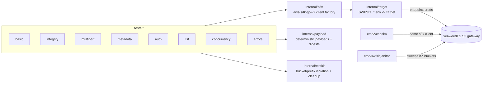

# seaweedfs-s3-harness

A realistic integration-test harness for [SeaweedFS](https://github.com/seaweedfs/seaweedfs)'s
S3 gateway, built to evaluate it as the object-storage backend for
[VCAP](https://github.com/upayanmazumder-DevLabs), a university capstone
portal. It verifies **bytes and digests**, not just HTTP status codes, and
is structured so the same test suite can run against any S3-compatible
endpoint (SeaweedFS, AWS S3, or another gateway) to distinguish a real
SeaweedFS bug from a test bug, an application bug, or ordinary S3 behavior.

This is a research/evaluation tool, not a VCAP fork: it does not contain
VCAP's code, database, or auth layer. See [`docs/vcap-mapping.md`](docs/vcap-mapping.md)
for exactly which VCAP behaviors it mirrors and why.

## What's here, and what isn't yet

Implemented and passing against SeaweedFS 4.48 (see
[`docs/test-matrix.md`](docs/test-matrix.md) for the full list):
basic PUT/GET/HEAD/DELETE/LIST, multi-size integrity checks, the multipart
upload lifecycle (retry, abort, stale-ETag, out-of-order, entity-too-small,
delete/complete races), metadata/ETag/range/conditional-request behavior,
authentication and multi-identity authorization, listing pagination and
consistency, and several concurrency-race invariants - including regression
coverage for specific recently-fixed/open SeaweedFS issues (see
[`docs/test-matrix.md`](docs/test-matrix.md) for issue numbers).

**Not implemented yet** (tracked as follow-up, not claimed as done):
presigned-URL tests, Kubernetes pod-kill chaos tests, a second
reference-S3 target for automated three-way comparison, raw aws-chunked
fault injection, and automated diagnostics-bundle collection. The
`target`/`s3x` abstractions are built so these can be added without
touching existing tests.

## Architecture



- **`internal/payload`** generates deterministic, seekable test payloads
  (random/zero/cyclic byte patterns) and verifies downloaded bytes by
  SHA-256/MD5, reporting the exact byte offset of any mismatch.
- **`internal/s3x`** builds `aws-sdk-go-v2` S3 clients: path-style,
  multiple identities (admin/read-only/scoped), both SDK checksum modes,
  and deliberately-wrong credentials for negative tests.
- **`internal/target`** loads an S3-compatible endpoint description purely
  from `SWFSIT_*` environment variables - no target file ever holds a
  credential.
- **`internal/testkit`** gives every test an isolated bucket and key prefix,
  with automatic cleanup (including aborting in-flight multipart uploads)
  even on failure, plus S3 error-code/status helpers.
- **`cmd/vcapsim`** is a small, VCAP-shaped workload (not a VCAP clone - see
  [`docs/vcap-mapping.md`](docs/vcap-mapping.md)): upload a workspace ZIP,
  "compile" it deterministically, upload the resulting PDF/log, delete the
  workspace, verify everything downloaded matches what was produced.
- **`cmd/swfsit`** is the harness CLI (today: `janitor`, which sweeps
  leftover `it-*` buckets from interrupted runs).

## Prerequisites

- Go 1.26+
- Docker + Docker Compose v2, for the local lane
- `kubectl` and Helm 3.13+, only if deploying to Kubernetes

## Local setup

```bash
git clone https://github.com/upayanmazumder-DevLabs/seaweedfs-s3-harness
cd seaweedfs-s3-harness
make build                # compiles everything
make test-unit            # internal/payload unit tests, no network needed
make compose-up           # generates random S3 credentials into .secrets/
                           # (gitignored) and starts SeaweedFS 4.48
```

`make compose-up` runs [`scripts/gen-secrets.sh`](scripts/gen-secrets.sh)
first, which writes random admin/read-only/scoped S3 identities to
`.secrets/` - **never commit this directory** (it's gitignored).

## Running tests

```bash
make compose-test     # compose-up, then run the full suite against it
# or, with the stack already up:
set -a; source .secrets/compose.env; set +a
go test -v ./tests/...                 # everything
go test -v ./tests/multipart/...       # one category
go test -v ./tests/multipart/ -run TestAbortCleansUpEverything  # one test
go test -short ./tests/...             # skip the slowest (100 MiB, concurrency) cases
```

Output follows normal `go test` conventions (`--- PASS`/`--- FAIL` per
test). For CI-style structured output, pipe through
[`gotestsum`](https://github.com/gotestyourself/gotestsum):
`gotestsum --format testname -- -v ./tests/...`.

Tests read their target purely from environment variables (see
[`internal/target/target.go`](internal/target/target.go) for the full
list): `SWFSIT_TARGET_NAME`, `SWFSIT_ENDPOINT`, `SWFSIT_ACCESS_KEY`,
`SWFSIT_SECRET_KEY` are required; everything else has a default or makes a
test `t.Skip` cleanly (for example, `SWFSIT_RO_ACCESS_KEY`/
`SWFSIT_SCOPED_ACCESS_KEY` gate the multi-identity auth tests).

## SeaweedFS deployment

### Local (Docker Compose)

[`deploy/compose/docker-compose.yaml`](deploy/compose/docker-compose.yaml)
runs `chrislusf/seaweedfs:4.48` as a single all-in-one `weed server
-master -volume -filer -s3`, with S3 auth enabled and identities loaded
from the file `gen-secrets.sh` generates. This is what `make compose-up`
and CI both use.

### Kubernetes

This repo does not vendor a Helm chart - it uses the **official** chart,
`https://seaweedfs.github.io/seaweedfs/helm`, pinned at `4.48.0`, with a
split master/volume/filer/s3-gateway topology (not `allInOne`, so the S3
gateway can be restarted independently of the filer). Example values are
under `deploy/helm/seaweedfs/values-*.yaml`.

Key choices, and why (see `docs/test-matrix.md` and the chart's own
`values.yaml` for the defaults these override):

- `global.seaweedfs.createClusterRole: false` - the chart defaults this to
  `true`; the harness needs no cluster-scoped RBAC.
- Persistent storage (`type: persistentVolumeClaim`) for master, volume and
  filer - the chart's defaults are `hostPath`, which doesn't survive a
  rescheduled pod and typically fails under a Pod Security `baseline`
  policy.
- `s3.existingConfigSecret` pointing at a Secret the harness creates itself
  - **never** the chart's auto-generated secret, which uses Helm's
    `lookup` function and can silently rotate credentials on a GitOps
    resync.
- A low `master.volumeSizeLimitMB` (default chart value: 1000; binary
  default: 30000) - each S3 bucket is its own SeaweedFS collection, and
  the default pre-allocates far more volume capacity than a small test
  cluster has disk for.

This project **deploys to its author's real k3s cluster through a GitOps
pull request into a separate, private infrastructure repository** - not by
`kubectl apply` from this repo. That repo's conventions (namespace
isolation, resource budgets, SOPS-encrypted secrets, ArgoCD sync policy)
are out of scope for a public repository and are not included here. If
you're adapting this harness to your own cluster, `deploy/helm/seaweedfs/`
plus the `s3-secret` keys documented above are the complete, portable
input - wire them into whatever GitOps or `helm install` flow your cluster
already uses.

## Configuration reference

All configuration is environment variables consumed by
[`internal/target`](internal/target/target.go); there is deliberately no
config-file format that could hold a credential.

| Variable | Required | Meaning |
|---|---|---|
| `SWFSIT_TARGET_NAME` | yes | label for this target, used in output/diagnostics |
| `SWFSIT_ENDPOINT` | yes | S3 endpoint URL, e.g. `http://127.0.0.1:8333` |
| `SWFSIT_ACCESS_KEY` / `SWFSIT_SECRET_KEY` | yes | admin identity |
| `SWFSIT_REGION` | no (default `us-east-1`) | |
| `SWFSIT_PATH_STYLE` | no (default `true`) | |
| `SWFSIT_RO_ACCESS_KEY` / `SWFSIT_RO_SECRET_KEY` | no | enables the read-only-identity auth tests |
| `SWFSIT_SCOPED_ACCESS_KEY` / `SWFSIT_SCOPED_SECRET_KEY` / `SWFSIT_SCOPED_BUCKET` | no | enables the bucket-scoped-identity auth test |
| `SWFSIT_VERSIONING` | no (default `true`) | gates versioning-dependent tests |
| `SWFSIT_MAX_OBJECT_MIB` | no (default `100`) | caps generated object sizes for this target |

## Collecting diagnostics

On any failure, re-run the single failing test verbosely and capture the
server's own state:

```bash
go test -v ./tests/<pkg>/ -run '^TestName$'
docker compose -f deploy/compose/docker-compose.yaml logs seaweedfs > seaweedfs.log
```

Every test failure message already includes the payload's seed, size and
pattern (see `payload.Payload.Describe()`), and integrity failures report
the exact first differing byte offset - that's normally enough to write a
standalone reproducer (see below) without re-running the whole suite.

## Interpreting failures

A failing test is not automatically a SeaweedFS bug. Before concluding
that, check in order:

1. **Test bug** - does the test correctly reflect documented S3 behavior?
   Re-read the relevant AWS API reference.
2. **Application bug** - if the failure is in `cmd/vcapsim`, not
   `tests/*`, the bug may be in vcapsim's own logic, not the S3 server.
3. **Expected S3 behavior / SeaweedFS-documented deviation** - SeaweedFS's
   own wiki documents some intentional differences from AWS (for example,
   only `/` is a reliable delimiter, and `DeleteObject` also deletes empty
   parent folders). Check the
   [Amazon S3 API wiki page](https://github.com/seaweedfs/seaweedfs/wiki/Amazon-S3-API)
   first.
4. **SeaweedFS compatibility issue** - reproduce it, then check if it's
   already a known/fixed issue (search `seaweedfs/seaweedfs` issues for the
   operation name).
5. **Potential new SeaweedFS bug** - if none of the above applies, reduce
   to a minimal reproducer (see below) before filing anything.

## Reproducing and reporting a suspicious failure

1. Reduce the failing test to the smallest `go test -run` invocation that
   still fails.
2. Re-run against a fresh `chrislusf/seaweedfs:4.48` compose stack (`make
   compose-down && make compose-up`) to rule out state left over from a
   previous run.
3. Write a standalone `main.go` under `repro/<short-description>/` that
   reproduces the failure with nothing but `aws-sdk-go-v2` and the
   target's endpoint/credentials - no dependency on this repo's test
   framework. This is what you'd attach to an upstream issue.
4. Check `github.com/seaweedfs/seaweedfs`'s issue tracker for the
   operation and symptom before filing - see
   [`docs/test-matrix.md`](docs/test-matrix.md) for issue numbers this
   harness already has regression coverage for.
5. File using SeaweedFS's issue template (`.github/ISSUE_TEMPLATE.md` in
   their repo): describe the bug, the exact `weed` command line in use
   (from `deploy/compose/docker-compose.yaml` or your Helm values),
   `weed version`, expected vs. actual behavior, and attach the
   `repro/` reproducer.

## Security

- **Never commit** anything under `.secrets/`, any `*.env` file (except
  `*.env.example`), a kubeconfig, or an unredacted diagnostics bundle - see
  [`.gitignore`](.gitignore).
- All S3 credentials used by this repo's own CI/compose lane are generated
  fresh per run by [`scripts/gen-secrets.sh`](scripts/gen-secrets.sh) and
  thrown away with the container.
- There are no cloud credentials, cluster kubeconfigs, or private
  infrastructure details (hostnames, IPs, node names) anywhere in this
  repository, by design - this is a standalone public tool, not an export
  of anyone's production environment.

## License

MIT - see [`LICENSE`](LICENSE).
